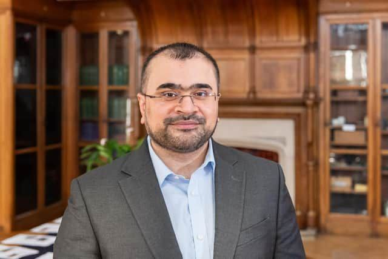

# Multimodal Data Analysis Session (MDAS)

Biomedical research often brings together measurements that describe different aspects of the same person. Multimodal data analysis asks how these complementary sources can be combined to address a research question, and how to evaluate what the combination adds.

Organised by the **CMI** AIRE team with the support of **UKOMAIN**, MDAS introduces practical examples from the PyKale biomedical research ecosystem. **KaleCancer** combines clinical variables and pathology patch features for classification and survival analysis. **KaleCardiac** explores chest X-ray and ECG representation learning with CardioVAE, and complementary ECG leads with LS-EMVAE.

Work through the examples with us at the workshop or independently afterwards. The materials explain the inputs, modelling choices and evaluation, starting with synthetic data so no patient dataset is needed.

## Explore the examples

[Explore Cancer](tutorials/kalecancer/index.md) or [Explore Cardiac](tutorials/kalecardiac/getting-started.md). The Cancer notebooks can run on this website with Binder or in a dedicated Google Colab copy; Cardiac examples have local setup instructions.

For preparation and privacy guidance, see the [Participation Guide](docs/participation.md). To start an example immediately, use [Quick Start](docs/quick-start.md).

## Workshop details

| Date | Attendee programme | Venue |
| --- | --- | --- |
| Wednesday, 18 November 2026 | 13:00–17:00 | Ada Lovelace, University of Sheffield |

Synthetic demonstrations teach the software workflow; they do not establish clinical performance. Keep patient data and confidential research off public execution services.

## Acknowledgement

We gratefully acknowledge the collaborative contributions and insightful discussions provided by Bilal Tahir, Daniele Tartarini, Zhiyang Chen and Daniel Griffin throughout the KaleCancer project.
