# Cancer

[KaleCancer](https://github.com/pykale/cancer) combines clinical variables and pathology slide features to explore cancer research questions. The examples follow the same workflow: load the inputs, prepare a model, train it, then evaluate and interpret its predictions.

## Choose an example

| Example | What it demonstrates |
| --- | --- |
| [KaleCancer Classification](../../notebooks/MDAS/cancer/classification_showcase.ipynb) | Predict a category, compare the contribution of different inputs, and explore what the model uses. |
| [KaleCancer Survival Analysis](../../notebooks/MDAS/cancer/survival_showcase.ipynb) | Analyse event risk with incomplete follow-up, evaluate survival predictions, and explore individual explanations. |

Both examples use synthetic clinical data and generated pathology patch features. These are numerical demonstrations, not patient images or evidence of clinical performance.

## From data to interpretation

The arrows trace the existing workflow from data loading through model training to evaluation and interpretation. Motion is decorative; the complete diagram remains readable without animation and when reduced motion is requested.

## Run an example

Each example page offers **Run with Binder** and **Run in Google Colab**, with its own setup guidance. For **Run locally**, follow [Quick Start](../../docs/quick-start.md#cancer). Read the saved outputs first if you want to understand the sequence before launching a temporary session.

Use subject-level separation, fit preprocessing on training data and examine uncertainty. A successful synthetic run establishes that the workflow executes, not that it generalises to clinical use. Keep patient and confidential data off public execution services.
