# Cancer

In the Cancer tutorial, we will use [KaleCancer](https://github.com/pykale/cancer) to combine clinical variables and pathology slide features and explore cancer research questions. The examples follow the same workflow: load the inputs, prepare a model, train it, then evaluate and interpret its predictions.

## Choose an example

| Example | What it demonstrates |
| --- | --- |
| [Classification](../../notebooks/MDAS/cancer/classification_showcase.ipynb) | Predict a category, compare the contribution of different inputs, and explore what the model uses. |
| [Survival Analysis](../../notebooks/MDAS/cancer/survival_showcase.ipynb) | Analyse event risk with incomplete follow-up, evaluate survival predictions, and explore individual explanations. |
| [Exploring HANCOCK](../../notebooks/MDAS/cancer/hancock_questions.ipynb) | Hands-on: answer research questions on a real head and neck cancer cohort by changing a line or two. |

Classification and Survival Analysis use synthetic clinical data and generated pathology patch features. Exploring HANCOCK uses a reduced copy of the public [HANCOCK](https://hancock.research.fau.eu) cohort (CC BY 4.0), downloaded automatically by the notebook. None of these results are evidence of clinical performance.

## From data to interpretation

The arrows trace the existing workflow from data loading through model training to evaluation and interpretation. Motion is decorative; the complete diagram remains readable without animation and when reduced motion is requested.

## What you will do

1. Prepare and load synthetic clinical data and pathology patch features.
2. Build and train a model for classification or survival analysis.
3. Evaluate the model's predictions.
4. Interpret the results and explore how the inputs contribute.

For execution options, see [Quick Start](../../docs/quick-start.md#cancer).

Use subject-level separation, fit preprocessing on training data and examine uncertainty. A successful synthetic run establishes that the workflow executes, not that it generalises to clinical use. Keep patient and confidential data off public execution services.
